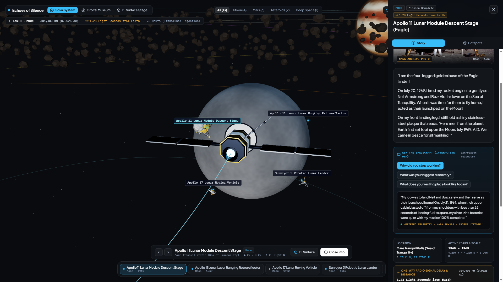
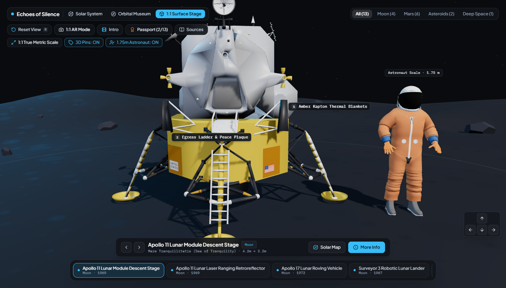
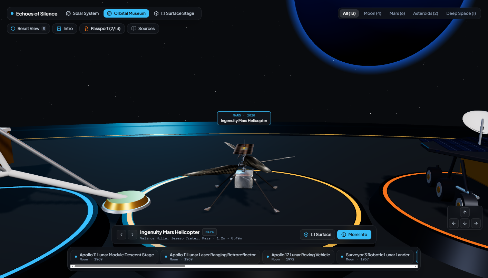
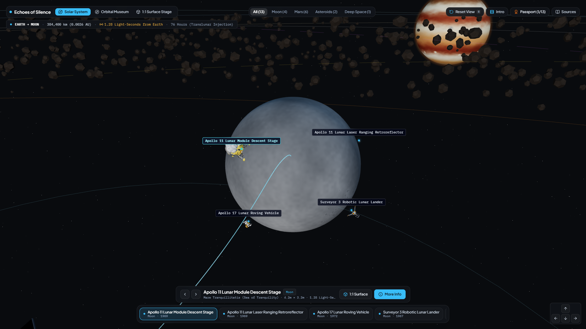
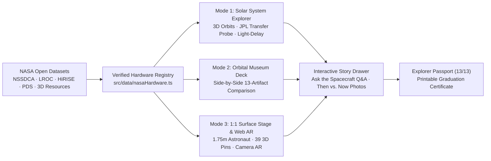

<div align="center">

# ECHOES OF SILENCE
### *The Solar System's Living Museum – 1:1 Scale 3D & Web AR Exhibition*

[](https://spaghetti-coders-neon.vercel.app)
[](./LICENSE)

**Challenge:** *Abandoned but not Forgotten: Storytelling about NASA's Discarded Equipment on the Moon and Mars*  
**Team:** Spaghetti Coders (Omar, Bashar, and Youssef) · **Repository:** [GitHub Repository](https://github.com/omarsh4114/NASA-Abandoned-Not-Forgotten-404)

</div>
---

## Visual Preview

> **Experience 13 silent NASA spacecraft at true 1:1 metric scale—from heliocentric orbital trajectories and one-way radio light-delay down to planetary surface stages and live mobile AR.**

| Heliocentric Solar System, Light-Delay & Story Q&A | 1:1 Surface Stage & 1.75m Astronaut Scale Reference |
| :---: | :---: |
|  |  |
| *Trace real Earth-to-target transfer trajectories, view one-way radio light-delay, and ask spacecraft first-person questions.* | *Stand beside Apollo 11's Eagle lander at true 1:1 metric scale next to a 1.75m astronaut and inspect 3D subsystem pins.* |
| **Orbital Museum Deck (13-Spacecraft Gallery)** | **3D Solar System Explorer & Lunar Landing Sites** |
|  |  |
| *Compare all 13 historic NASA landers, rovers, helicopters, and deep-space probes side-by-side on museum pedestals.* | *Explore verified landing pins across the Moon, Mars, Asteroid 433 Eros, Dwarf Planet Ceres, and Deep Space.* |

---

## The Problem & Our Solution

**The Problem:** Decades of exploration have left historic NASA landers, rovers, and probes resting silently across the Moon, Mars, asteroids, and deep space. To students and the general public, raw coordinate tables and technical archives make these priceless scientific monuments feel like forgotten "space junk," while 2D photos hide their true human scale and vast speed-of-light distance from Earth.

**Our Solution:** *Echoes of Silence* transforms **13 iconic NASA spacecraft** across **5 celestial worlds** into a zero-install, browser-based **1:1 metric-scale 3D museum and WebRTC AR experience**. Learners can fly along real orbital transfer trajectories, compare all 13 machines side-by-side, walk around them at `1:1` human scale next to a `1.75 m` astronaut, compare historic **Mission Photos** with modern **LROC / HiRISE Orbital Reconnaissance**, and interview each machine in the first person via **"Ask the Spacecraft"** interactive Q&A chips.

---

## Designed for Every Learner (Multi-Tier Educational Impact)

To maximize classroom and public impact across all age brackets, *Echoes of Silence* supports three progressive discovery tiers:

| Audience Tier | Interactive Experience Inside the App | Learning Outcome |
| :--- | :--- | :--- |
| **1. Young Explorers (Ages 10–14)** | First-person **"Ask the Spacecraft" Q&A** (*"Why did you stop working?"*, *"What was your biggest discovery?"*), **1.75m Astronaut** size comparison, and the **13/13 Explorer Passport & Printable Certificate**. | Builds intuitive spatial scale, empathy, and excitement for space archaeology without technical jargon. |
| **2. High School STEM & Physics** | **39 Interactive 3D Engineering Pins** (Kapton thermal blankets, RTGs, Rocker-Bogie suspension, SEIS seismometer) and **One-Way Radio Light-Delay Telemetry** (`1.28 Light-Seconds` to `~18.6 Light-Hours`). | Connects orbital mechanics, speed-of-light communication delays, and extreme planetary engineering to real missions. |
| **3. Educators & Space Enthusiasts** | **Verified IAU Coordinates** with one-click deep links to official **NASA NSSDCA / LROC / HiRISE / PDS Archives**, **"Then vs. Now" Image Switcher**, and **Live Mobile Camera AR**. | Enables zero-install 15-minute classroom demonstrations backed by verifiable public-domain NASA records. |

---

## How It Works (System Architecture)



### Core Technical Features

* **3-Tier Seamless Spatial Navigation:** Transition smoothly between **Solar System Explorer**, **Orbital Museum Deck**, and **1:1 Surface Stage** (`R` shortcut resets camera framing at any time).
* **1:1 True Metric Scale & WebRTC AR Passthrough:** Every spacecraft is scaled accurately in meters (`1 Three.js unit = 1 meter`) alongside an opaque **1.75m Astronaut** reference figure and can be projected into your room via live device camera AR.
* **"Ask the Spacecraft" Interactive First-Person Q&A:** 39 student-friendly question chips across all 13 artifacts answer *why* the machine went silent, *what* it discovered, and *how* its resting site looks today—paired with verified NASA telemetry tags.
* **Real-Time Speed-of-Light Radio Delay Readouts:** Displays the exact one-way radio light-time from Earth (`1.28 Light-Seconds` on the Moon, `~14.2–17.6 Light-Minutes` on Mars, `~23.1 Light-Minutes` at Ceres, and `~18.6 Light-Hours` in Deep Space).
* **"Then vs. Now" Archival & Orbital Recon Switcher:** Toggle between historic surface photography and overhead LROC / MRO HiRISE reconnaissance, backed by an offline SVG NASA Telemetry Blueprint fallback so zero broken images ever occur.

---

## The 13 Historic Spacecraft Archive

| # | Spacecraft | Celestial Destination | Verified Coordinates | True Metric Dimensions (`W × D × H`) | Primary NASA Data Source |
| :--- | :--- | :--- | :--- | :--- | :--- |
| **01** | **Apollo 11 Lunar Module *Eagle* (Descent Stage)** | Moon · Sea of Tranquility | `0.6741° N, 23.4730° E` | `4.20m × 4.20m × 3.20m` | [LROC / NSSDCA `1969-059C`](https://nssdc.gsfc.nasa.gov/nmc/spacecraft/display.action?id=1969-059C) |
| **02** | **Apollo 11 Laser Ranging Retroreflector (LRRR)** | Moon · Tranquility Base | `0.6734° N, 23.4729° E` | `0.46m × 0.46m × 0.30m` | [PDS / NSSDCA `1969-059A-04`](https://nssdc.gsfc.nasa.gov/nmc/experiment/display.action?id=1969-059A-04) |
| **03** | **Apollo 17 Lunar Roving Vehicle (LRV-3)** | Moon · Taurus-Littrow Valley | `20.1908° N, 30.7717° E` | `3.10m × 2.06m × 1.14m` | [LROC / NSSDCA `1972-096C`](https://nssdc.gsfc.nasa.gov/nmc/spacecraft/display.action?id=1972-096C) |
| **04** | **Surveyor 3 Robotic Lunar Lander** | Moon · Oceanus Procellarum | `3.0124° S, 23.4216° W` | `4.00m × 4.00m × 3.00m` | [LROC / NSSDCA `1967-035A`](https://nssdc.gsfc.nasa.gov/nmc/spacecraft/display.action?id=1967-035A) |
| **05** | **Ingenuity Mars Helicopter (*Ginny*)** | Mars · Valinor Hills, Jezero Crater | `18.4447° N, 77.4508° E` | `1.20m × 1.20m × 0.49m` | [HiRISE / NSSDCA `2020-052B`](https://nssdc.gsfc.nasa.gov/nmc/spacecraft/display.action?id=2020-052B) |
| **06** | **Opportunity Rover (MER-B)** | Mars · Perseverance Valley | `1.9462° S, 354.4734° E` | `2.30m × 1.60m × 1.50m` | [HiRISE / NSSDCA `2003-032A`](https://nssdc.gsfc.nasa.gov/nmc/spacecraft/display.action?id=2003-032A) |
| **07** | **Spirit Rover (MER-A)** | Mars · Troy Sand Trap, Gusev Crater | `14.5684° S, 175.4726° E` | `2.30m × 1.60m × 1.50m` | [HiRISE / NSSDCA `2003-027A`](https://nssdc.gsfc.nasa.gov/nmc/spacecraft/display.action?id=2003-027A) |
| **08** | **InSight Mars Geophysical Lander** | Mars · Elysium Planitia | `4.5024° N, 135.6234° E` | `6.00m × 1.56m × 1.08m` | [PDS SEIS / NSSDCA `2018-042A`](https://nssdc.gsfc.nasa.gov/nmc/spacecraft/display.action?id=2018-042A) |
| **09** | **Phoenix Polar Mars Lander** | Mars · Vastitas Borealis | `68.2188° N, 234.2508° E` | `5.50m × 1.50m × 2.20m` | [HiRISE / NSSDCA `2007-034A`](https://nssdc.gsfc.nasa.gov/nmc/spacecraft/display.action?id=2007-034A) |
| **10** | **Sojourner Mars Microrover** | Mars · Ares Vallis | `19.1300° N, 33.2200° W` | `0.65m × 0.48m × 0.30m` | [HiRISE / NSSDCA `1996-068A`](https://nssdc.gsfc.nasa.gov/nmc/spacecraft/display.action?id=1996-068A) |
| **11** | **NEAR Shoemaker Asteroid Probe** | Asteroid · 433 Eros (Himeros Saddle) | `35.0° S, 324.0° E` | `1.70m × 1.70m × 2.75m` | [PDS SBN / NSSDCA `1996-008A`](https://nssdc.gsfc.nasa.gov/nmc/spacecraft/display.action?id=1996-008A) |
| **12** | **Dawn Ion Propulsion Spacecraft** | Dwarf Planet · 1 Ceres Orbit | `24.0° N, 145.0° E (Orbit)` | `19.70m × 1.60m × 2.36m` | [PDS SBN / NSSDCA `2007-043A`](https://nssdc.gsfc.nasa.gov/nmc/spacecraft/display.action?id=2007-043A) |
| **13** | **Kepler Space Telescope** | Deep Space · Earth-Trailing Orbit | `1.05 AU Heliocentric` | `2.70m × 2.70m × 4.70m` | [Exoplanet Archive / `2009-011A`](https://nssdc.gsfc.nasa.gov/nmc/spacecraft/display.action?id=2009-011A) |

---

## Classroom STEM Activity (15-Minute Guided Lab)

1. **Human Scale Comparison:** Open **Apollo 11 *Eagle*** (`4.20m × 3.20m`) and **Sojourner Microrover** (`0.65m × 0.30m`) in **1:1 Surface Stage** with the **1.75m Astronaut** enabled. Compare their dimensions—which rover is the size of a microwave oven?
2. **Speed-of-Light Delay:** Switch to **Solar System Explorer** and compare the one-way radio signal delay between the Moon (`1.28 Light-Seconds`), Mars (`~14.2 Light-Minutes`), and Deep Space (`~18.6 Light-Hours`). Why couldn't engineers steer Mars rovers with a live joystick?
3. **Engineering Failure Analysis:** Open **More Info** on **Opportunity Rover** or **Ingenuity** and click the **"Ask the Spacecraft"** Q&A chips to discover how Martian dust storms and thin `1%` atmospheric density ended their historic missions.

---

## Local Setup & Project Structure

```text
├── docs/media/                     # Live application screenshots for GitHub storefront
├── public/models/                  # Official NASA .glb spacecraft meshes
├── src/
│   ├── components/
│   │   ├── solar-system/           # Heliocentric 3D Solar System, Planets & JPL Transfer Probe
│   │   ├── stage/                  # Orbital Museum Deck & 1:1 Planetary Surface Stage
│   │   ├── models/                 # Unified 13 Spacecraft PBR Assemblies & 1.75m Astronaut
│   │   ├── ui/                     # SpatialHUD, Story/Hotspots Drawer & Ask-the-Spacecraft Q&A
│   │   ├── ArchaeologistPassport.tsx
│   │   └── CitationsAndAIDisclosure.tsx
│   ├── data/
│   │   └── nasaHardware.ts         # Verified telemetry, coordinates, Q&A & NASA archive links
│   └── types/
│       └── hardware.ts             # TypeScript schema for artifacts, hotspots & Q&A
├── AI_DISCLOSURE.md                # Mandatory NASA Space Apps AI/SI transparency statement
├── NASA_DATA_SOURCES.md            # Official NASA Open Data & GIS citations
└── LICENSE                         # MIT Open-Source License
```

```bash
# 1. Install dependencies
npm install

# 2. Start local development server
npm run dev

# 3. Type-check and build production bundle
npm run build
```

---

## Governance & Transparency

* **NASA Data Citations:** Full dataset references are documented in [`NASA_DATA_SOURCES.md`](./NASA_DATA_SOURCES.md).
* **AI Usage Disclosure:** Full transparency on development tools is documented in [`AI_DISCLOSURE.md`](./AI_DISCLOSURE.md).
* **Open-Source License:** Released under the [`MIT License`](./LICENSE).
